# System architecture

```mermaid
flowchart LR
  User[User] --> Browser[React dashboard\nCampaigns, leads, run logs]
  Browser -->|REST /api| Controllers[Spring Boot REST controllers]
  Controllers --> Campaigns[Campaign and collection services]
  Campaigns --> Collector[LinkedIn public-index collector]
  Collector -->|same campaign query| Tavily[Tavily Search API]
  Collector -->|same campaign query| Exa[Exa Search API]
  Collector -->|same campaign query| Serper[Serper Search API]
  Tavily -->|indexed results| Merge[Validate permalink, merge exact URL duplicates]
  Exa -->|indexed results| Merge
  Serper -->|indexed results| Merge
  Merge --> Qualify[Campaign terms, exclusions, intent filter]
  Qualify --> Enrich[App classification, contact-string extraction, provider metadata]
  Enrich --> Persistence[Spring Data JPA]
  Persistence -->|JDBC / PostgreSQL| Supabase[(Supabase PostgreSQL)]
  Supabase --> Persistence
  Persistence --> Controllers
  Controllers -->|leads, campaigns, run status, system status| Browser
```

## Request and data flow

1. The React app sends campaign, collection, lead, and dashboard requests to Spring Boot over REST.
2. A collection run selects active campaigns and their enabled sources. The LinkedIn collector sends each campaign query to the configured search providers in parallel.
3. The collector parses each provider's response, accepts only exact LinkedIn post permalink patterns, and merges matches by canonical URL. It filters results using campaign keywords, excluded terms, and commercial-intent phrases.
4. The collection service sanitizes the provider-returned title/text, fingerprints and deduplicates the result, assigns app-generated category/intent fields, extracts candidate contact strings from text, and records which providers returned the URL.
5. Spring Data JPA persists leads and run history to PostgreSQL. With the deployed datasource configured to Supabase's PostgreSQL endpoint, Supabase is the persistent store.
6. The dashboard reads those records and exposes the provider permalink so a person can verify the source directly.

## Access and data limitations

The collector calls the providers' search APIs only. It does not authenticate to LinkedIn, fetch post pages, use private endpoints, or circumvent CAPTCHA, authentication, or anti-bot controls. A search result is not proof that the post is still public or current. The UI labels result text and provider-supplied fields accordingly; app classifications and India-market signals are derived values, not provider facts.

Provider keys and Supabase credentials belong in the backend process/deployment secret store. They are not sent to the browser.
